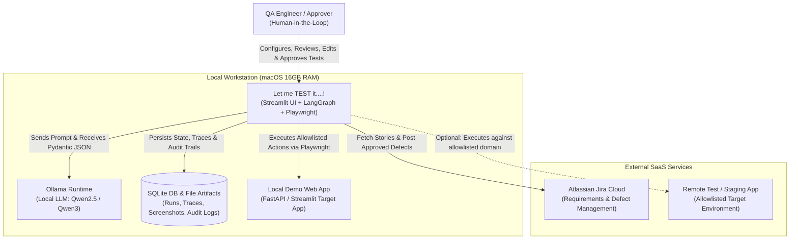
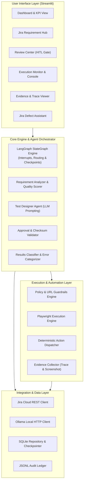
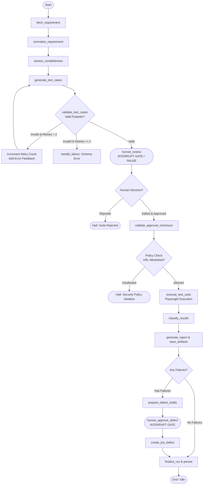
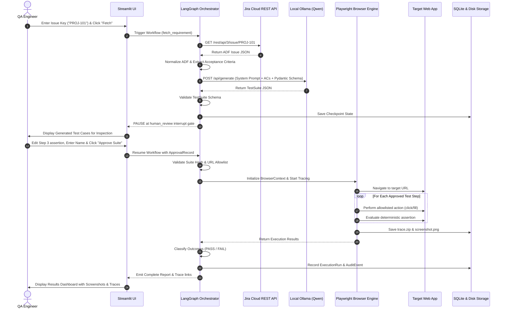
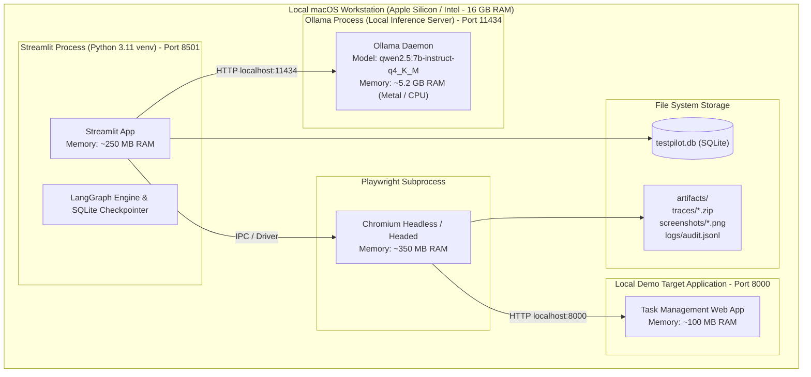

# System Architecture & Diagrams
## Product Name: Let me TEST it....! (TestPilot AI Engine)
**Document Version:** 1.0.0  
**Status:** Approved Baseline  
**Date:** October 2026  

---

## 1. System Context Diagram (C4 Level 1)

This diagram visualizes how **Let me TEST it....!** interfaces with external systems, human actors, local runtimes, and target environments.

---

## 2. Component Architecture Diagram (C4 Level 2)

This diagram illustrates the internal modular structure of the Python application.

---

## 3. Data-Flow Diagram (DFD)

This diagram tracks how data transforms from a Jira requirement into an approved test execution and resulting defect.

```mermaid
flowchart LR
    JiraIssue["Jira Cloud Issue<br/>(ADF JSON)"] -->|"1. Fetch & Normalize"| ReqObject["JiraRequirement<br/>(Clean Text)"]
    ReqObject -->|"2. Extract & Score"| ACs["Acceptance Criteria<br/>+ Quality Score"]
    ACs -->|"3. Prompt LLM"| RawLLM["Ollama JSON Stream"]
    RawLLM -->|"4. Pydantic Validate"| TestSuiteObj["Staged TestSuite<br/>(Pydantic Object)"]
    TestSuiteObj -->|"5. Human Edit & Sign"| ApprovedSuite["Approved TestSuite<br/>+ SHA256 Approval Record"]
    ApprovedSuite -->|"6. Guardrail Check"| AllowlistCheck{"URL in<br/>Allowlist?"}
    AllowlistCheck -->|No| SecurityError["Security Block Event"]
    AllowlistCheck -->|Yes| PlaywrightExec["Playwright Engine<br/>Context Execution"]
    PlaywrightExec -->|"7. Collect Evidence"| Artifacts["Traces, Screenshots<br/>& Execution Logs"]
    Artifacts -->|"8. Classify Outcome"| RunSummary["ExecutionRun<br/>(PASS / FAIL / ERROR)"]
    RunSummary -->|"9. If Failed: Propose Defect"| DefectDraftObj["DefectDraft<br/>(Markdown Bug Ticket)"]
    DefectDraftObj -->|"10. Human Sign-off"| JiraDefect["Jira Cloud Defect<br/>(BUG-XXX Created)"]
```

---

## 4. LangGraph Workflow State Diagram

This state diagram details the exact cyclic graph, conditional edges, retry loops, and human-in-the-loop interruption gates.

---

## 5. Sequence Diagram: Primary End-to-End Use Case

This sequence diagram illustrates the complete execution flow from requirement input to Playwright automation and reporting.

---

## 6. Local Mac Deployment Diagram

This deployment diagram details the process boundaries, memory budgets, and local network ports on macOS.

