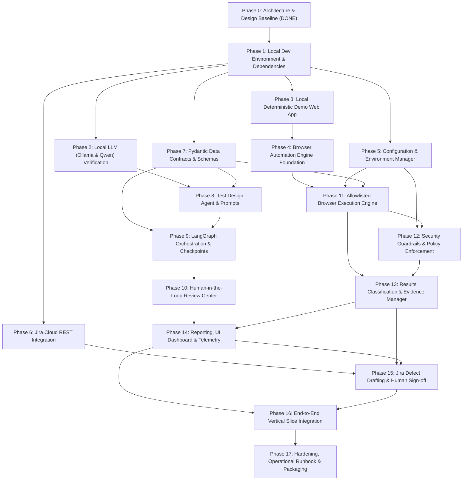

# Implementation Roadmap & Phase Dependencies
## Product Name: Let me TEST it....! (TestPilot AI Engine)
**Document Version:** 1.0.0  
**Status:** Approved Baseline  
**Date:** October 2026  

---

## 1. Phase Dependency Graph

---

## 2. Phase-by-Phase Work Breakdown Structure (WBS)

### Phase 0: Requirements and Design Baseline
- **Status:** **COMPLETED**
- **Deliverables:** `BRD.md`, `FRD.md`, `TECHNICAL_SPECIFICATION.md`, `ARCHITECTURE.md`, `SECURITY.md`, `TRACEABILITY_MATRIX.md`, `ROADMAP.md`.

---

### Phase 1: Local Development Environment & Dependencies
- **Goal:** Set up a clean, reproducible Python 3.11+ virtual environment, install pinned dependencies, configure `.gitignore` and `.env.example`, and verify Playwright browser binaries.
- **Key Files:** `pyproject.toml`, `requirements.txt`, `.gitignore`, `.env.example`.
- **Verification Commands:** `python3 -m venv .venv`, `source .venv/bin/activate`, `pip install -r requirements.txt`, `playwright install chromium`.

---

### Phase 2: Local LLM (Ollama & Qwen) Verification
- **Goal:** Install and verify Ollama daemon, pull `qwen2.5:7b` (or `3b` fallback), run latency benchmarks, and test structured JSON/Pydantic generation.
- **Key Files:** `app/agents/llm_client.py`, `tests/integration/test_ollama_contract.py`.
- **Verification Commands:** `ollama list`, `pytest tests/integration/test_ollama_contract.py`.

---

### Phase 3: Local Deterministic Demo Web Application
- **Goal:** Build a lightweight, stable Task Management web app with predictable elements, accessible ARIA roles, and test IDs for safe, offline test automation.
- **Key Files:** `demo_app/main.py`, `demo_app/templates/index.html`.
- **Verification Commands:** `python demo_app/main.py` -> Open `http://localhost:8000`.

---

### Phase 4: Browser Automation Foundation
- **Goal:** Implement clean Playwright context lifecycle, priority-based locators (ARIA Role -> Text -> TestID), explicit waits, deterministic assertions, screenshots, and trace recording.
- **Key Files:** `app/browser/context.py`, `app/browser/locators.py`, `app/browser/evidence.py`.
- **Verification Commands:** `pytest tests/integration/test_browser_foundation.py`.

---

### Phase 5: Configuration & Environment Manager
- **Goal:** Centralize settings, environment profiles (`local`, `test`, `staging`), URL allowlists, and secret redaction utilities.
- **Key Files:** `app/config.py`, `app/policies/guardrails.py`, `app/policies/redaction.py`.
- **Verification Commands:** `pytest tests/unit/test_config_and_policies.py`.

---

### Phase 6: Jira Cloud REST Integration
- **Goal:** Implement authenticated Jira client, parse Atlassian Document Format (ADF) into clean Markdown, handle rate limits and mock API errors.
- **Key Files:** `app/jira/client.py`, `app/jira/normalizer.py`, `tests/unit/test_jira_client.py`.
- **Verification Commands:** `pytest tests/unit/test_jira_client.py`.

---

### Phase 7: Pydantic Data Contracts
- **Goal:** Implement the complete typed data models: `JiraRequirement`, `AcceptanceCriterion`, `TestSuite`, `TestCase`, `TestStep`, `ApprovalRecord`, `ExecutionRun`, `DefectDraft`.
- **Key Files:** `app/models/requirements.py`, `app/models/test_suite.py`, `app/models/execution.py`, `app/models/defects.py`.
- **Verification Commands:** `pytest tests/unit/test_models.py`.

---

### Phase 8: Test-Design Agent
- **Goal:** Build prompt templates and Ollama generation pipeline to extract Acceptance Criteria and synthesize schema-compliant, traceable test suites with self-correcting retry logic.
- **Key Files:** `app/test_design/generator.py`, `app/test_design/prompts.py`, `tests/unit/test_generator.py`.
- **Verification Commands:** `pytest tests/unit/test_generator.py`.

---

### Phase 9: LangGraph Orchestration & Checkpointing
- **Goal:** Build the complete `StateGraph` with explicit nodes, conditional edges, error handlers, and SQLite checkpointing.
- **Key Files:** `app/graph/state.py`, `app/graph/workflow.py`, `app/persistence/checkpointer.py`.
- **Verification Commands:** `pytest tests/unit/test_langgraph_workflow.py`.

---

### Phase 10: Human-in-the-Loop Review Center
- **Goal:** Implement Streamlit Review Center screen for viewing generated tests, editing steps, validating edits against Pydantic, and recording immutable cryptographic approval records.
- **Key Files:** `app/ui/components/review_center.py`, `app/agents/nodes/human_review.py`.
- **Verification Commands:** Interactive UI test & unit test of approval hash verification.

---

### Phase 11: Allowlisted Browser Execution Engine
- **Goal:** Dispatch approved test steps to Playwright; evaluate deterministic assertions without LLM hallucination.
- **Key Files:** `app/browser/executor.py`, `app/browser/dispatcher.py`.
- **Verification Commands:** Run execution against local demo app.

---

### Phase 12: Security Guardrails & Policy Enforcement
- **Goal:** Implement domain allowlist enforcement, prompt injection delimiters, secret redaction in logs, and negative penetration tests.
- **Key Files:** `app/policies/guardrails.py`, `tests/safety/test_policy_guardrails.py`.
- **Verification Commands:** `pytest tests/safety/test_policy_guardrails.py`.

---

### Phase 13: Results Classification & Evidence Manager
- **Goal:** Classify test results into PASS, FAIL (App Defect), ERROR (Locator), BLOCKED (Network); persist traces, screenshots, and logs.
- **Key Files:** `app/reporting/classifier.py`, `app/browser/evidence.py`.
- **Verification Commands:** `pytest tests/unit/test_classifier.py`.

---

### Phase 14: Reporting, UI Dashboard & Telemetry
- **Goal:** Build comprehensive Streamlit screens for Dashboard, Results, Evidence Viewer, Run History, and SQLite metric storage.
- **Key Files:** `app/ui/views/*.py`, `app/persistence/repository.py`.
- **Verification Commands:** Streamlit UI verification.

---

### Phase 15: Jira Defect Workflow
- **Goal:** Generate structured defect drafts for failed tests with repro steps and evidence; require human confirmation; submit to Jira API.
- **Key Files:** `app/jira/defects.py`, `app/ui/components/defect_modal.py`.
- **Verification Commands:** `pytest tests/integration/test_defect_workflow.py`.

---

### Phase 16: End-to-End Vertical Slice Integration
- **Goal:** Verify complete automated flow: Jira Fetch -> AC Extraction -> Test Generation -> Human Approval -> Playwright Run -> Evidence -> Defect Draft.
- **Key Files:** `tests/end_to_end/test_full_workflow.py`.
- **Verification Commands:** `pytest tests/end_to_end/test_full_workflow.py`.

---

### Phase 17: Hardening, Operational Runbook & Packaging
- **Goal:** Finalize documentation, setup guides, error recovery guides, Dockerfile (optional), and production readiness review.
- **Key Files:** `README.md`, `RUNBOOK.md`, `TEST_STRATEGY.md`.

